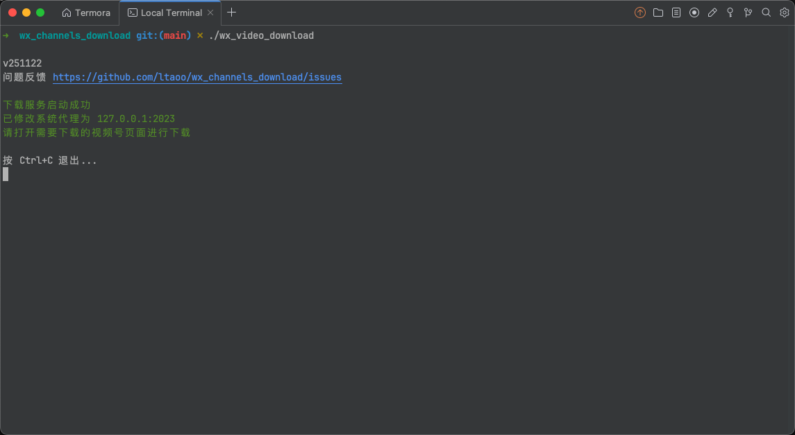
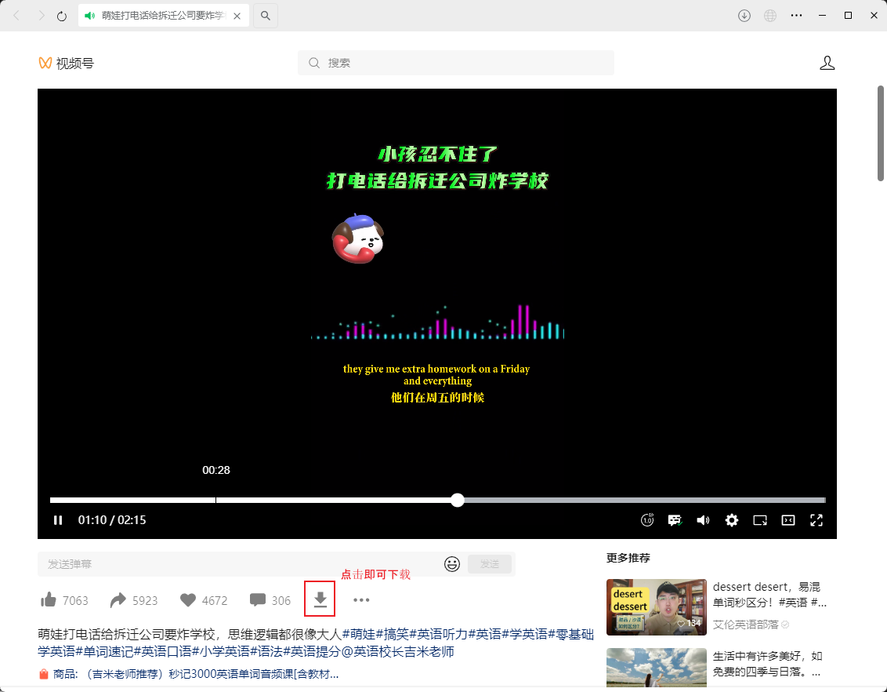
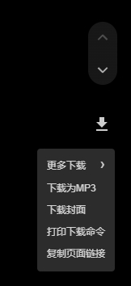
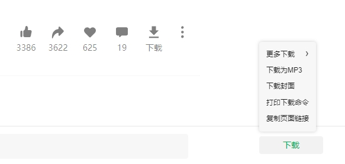
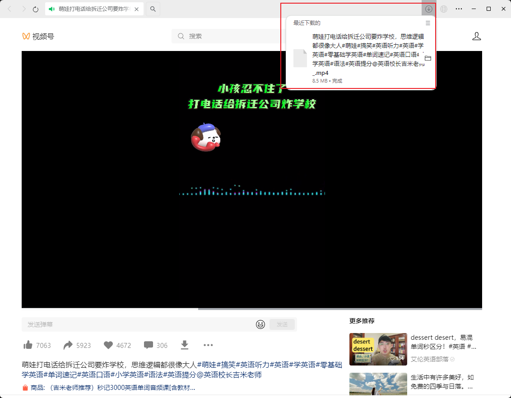

# 微信视频号下载器

体积小、使用简单、支持 macOS 和 Windows 系统。

## 使用说明

下载[构建包](https://github.com/ltaoo/wx_channels_download/releases)并运行，启动时优先使用配置的证书，否则依次复用已受信任的 mitmproxy、SunnyNet 根证书；没有可用证书时才生成本机根证书，并按配置自动安装，然后启动服务。

当终端提示「代理服务启动成功」就说明可以使用了。



> 已安装证书会跳过安装证书步骤。Windows 安装证书需要管理员权限；macOS 默认使用当前用户的“登录”钥匙串，设置系统代理或启用 TUN 的权限需求另计。

打开微信 PC 端，点击需要下载的视频，在视频下方的操作按钮一栏，会多出一个下载按钮，如下所示



如果没有，在页面侧边或底部会有悬浮按钮，拥有相同的功能

| 首页推荐 | 视频详情页 |
| --- | --- |
|  |  |


等待视频开始播放，然后暂停视频，点击下载按扭即可下载视频。下载成功后，会在上方显示已下载的文件，下载文件名最后面会标志该视频质量。



下载按钮默认会下载视频号默认质量的视频（即当前播放的视频，一般都是体积最小的），可以在下拉菜单下载其他质量的视频


## 证书与安全模型

程序通过本地 HTTPS 代理解密并修改视频号响应。启动时优先使用配置的证书；未配置时依次检查 mitmproxy、SunnyNet 根证书，已有受信任的证书则沿用且不改写配置，否则生成随机密钥的本机专属 CA，证书和私钥保存在工作目录的 `certs/` 下，路径写入配置，后续启动复用。新生成的自有根证书默认使用 `wx_channels_download` 作为名称和颁发者，组织为 `dm.funzm.com`，每次生成独立随机密钥。私钥只保存在本机；已配置的有效自定义证书继续使用。

旧版 SunnyNet 根证书使用公开的共享私钥。已受信任的 SunnyNet 在没有配置证书和受信任的 mitmproxy 证书时会继续使用；如需切换到本机专属证书，可在设置的证书管理中替换旧证书。手动安装时，请使用本机导出的证书，详见[证书安装](docs/guide/certificate.md)。

## 开发说明

运行 `go run main.go`。Windows 安装证书需要管理员权限；macOS 证书操作使用当前用户身份，其他权限需求见上文。

## 打包

参考 `build/build.sh` 脚本。

## 感谢

前端解密部分参考自
<br>
https://github.com/kanadeblisst00/WechatVideoSniffer2.0
<br>

后端解密代码来自
<br>
https://github.com/Hanson/WechatSphDecrypt


## ⚠️ 免责声明

```text
本项目为开源项目
仅用于技术交流学习和研究的目的
请遵守法律法规,请勿用作任何非法用途
否则造成一切后果自负
若您下载并使用即视为您知晓并同意
```
