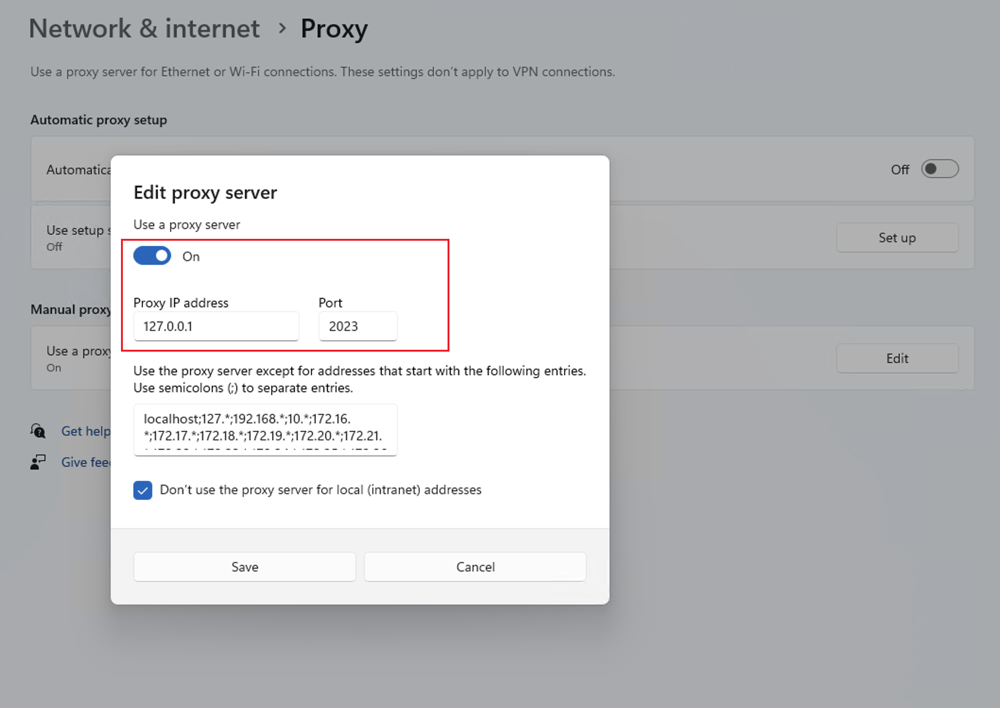
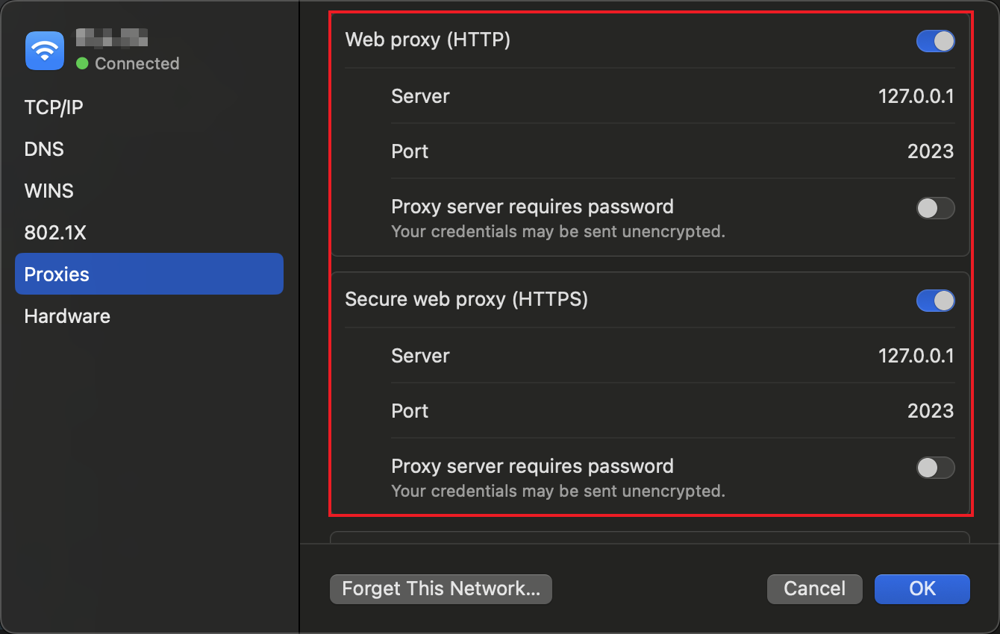

# 没有下载按钮

下载按钮由下载器向视频号页面注入。下载器进程仍在运行、视频可以播放，都不能单独证明视频号流量已经过下载器代理。

## 先做一次最小排查

1. 关闭已打开的视频号窗口，保留微信登录。
2. 暂时退出其他下载器和 Clash、Surge、VPN 等代理软件，再启动本下载器；如果需要依赖其他代理联网，请按下文的“与其他代理软件一起使用”配置。
3. 确认下载器没有提示启动失败，并保持它运行。
4. 从微信侧边“视频号”重新进入，打开一条普通视频，等待页面加载完成。不要只刷新启动下载器之前就已打开的页面。
5. 除视频下方的操作栏，也查看页面右侧或底部的悬浮下载按钮；位置示意见[使用步骤](../guide/step.md#兜底按钮)。

如果仍没有按钮，按下面的现象继续排查。

| 现象 | 优先检查 | 如何判断 |
| --- | --- | --- |
| 下载器提示启动失败、证书错误或端口占用 | 服务是否启动 | API 服务和代理服务需要分别确认 |
| 视频正常播放，但开启调试后仍没有对应页面的拦截或注入记录 | 流量是否经过代理、页面是否重新加载 | 系统代理开关开启，不等于微信实际使用了该代理 |
| 有页面拦截或注入记录，提示找不到操作栏 | 页面入口、按钮位置与版本适配 | 脚本可能已注入，但按钮挂载位置不匹配 |
| 页面空白、持续加载、证书警告或连接错误 | 代理连通性和证书信任 | 先恢复页面正常加载，再排查按钮 |
| 按钮出现，但提示无法连接下载服务或 WebSocket 断开 | API 服务及本地连接 | 代理端口和 API 端口用途不同 |

## 确认下载器服务正常

查看终端是否出现 `Startup failed`、`failed to start proxy service`、`address already in use` 等错误。出现错误时先处理对应问题，不要仅凭“API 服务启动成功”判断代理服务也已启动。

默认端口为：

- `127.0.0.1:2022`：API 和管理页面，供页面提交任务、连接下载服务。
- `127.0.0.1:2023`：HTTP 代理，供视频号流量经过下载器。

浏览器打开 `http://127.0.0.1:2022`，检查能否进入管理页面；当前版本也可以访问 `http://127.0.0.1:2022/api/status` 查看 `data.api` 和 `data.proxy` 的 `status`、`listening`。旧版若返回 404，请结合启动日志和端口检查，不要直接认定服务未启动。

Windows 可执行：

```powershell
netstat -ano | findstr ":2022"
netstat -ano | findstr ":2023"
```

macOS 可执行：

```sh
lsof -nP -iTCP:2022 -sTCP:LISTEN
lsof -nP -iTCP:2023 -sTCP:LISTEN
```

应看到监听记录，并确认对应进程是正在使用的下载器。没有监听时，先检查启动错误；端口被其他程序占用时，退出冲突程序，或修改配置后同步调整代理地址。只有 `SYN_SENT` 不能证明服务已启动或一定被防火墙拦截。

如果端口已监听但本地连接仍失败，检查安全软件的阻止记录、代理软件的本地地址绕过规则。仅在确认被拦截后允许该下载器的本地连接，无需先关闭全部防护或把监听地址改为 `0.0.0.0`。

以上地址均为默认值；修改过 `api` / `proxy` 配置时，所有检查都应使用实际地址和端口。不要把直接访问代理端口 `http://127.0.0.1:2023` 能否显示网页作为服务是否正常的判断依据。

## 终端一键收集诊断信息

先启动下载器，在微信中重新打开视频号并播放视频。选择下面对应系统的代码块，点击右上角的复制按钮，将完整代码粘贴到终端并按回车执行。命令仅读取状态并发起测试请求，不修改代理、防火墙或证书配置。默认使用本机 `2022` / `2023` 端口，改过配置时先修改命令开头的地址以及监听检查中的端口。

测试分为本地 API、直接 HTTPS、强制代理 HTTPS 三条路径。“直接”仅表示不使用 HTTP 代理，仍可能受到 VPN / TUN 影响；强制代理测试绕过系统代理选择和代理例外列表，用于单独验证下载器链路。

### Windows PowerShell

适用于 Windows 10/11，需要 `curl.exe`。复制下面完整代码块（包含开头的 `& {` 和末尾的 `}`），粘贴到 PowerShell 执行。请在运行微信的同一 Windows 用户下打开 PowerShell；若防火墙查询提示权限不足，可用同一用户的管理员终端重试。

```powershell
& {
  $ErrorActionPreference = 'Continue'
  $api = 'http://127.0.0.1:2022'
  $proxy = 'http://127.0.0.1:2023'
  $target = 'https://channels.weixin.qq.com/web/pages/home'

  Write-Host "`n[1] 系统代理和例外列表"
  Get-ItemProperty 'HKCU:\Software\Microsoft\Windows\CurrentVersion\Internet Settings' |
    Format-List ProxyEnable,ProxyServer,ProxyOverride,AutoConfigURL

  Write-Host "`n[2] 端口监听、代理连接和微信进程"
  Get-NetTCPConnection -LocalPort 2022,2023 -State Listen -ErrorAction Continue |
    Format-Table LocalAddress,LocalPort,OwningProcess
  Get-NetTCPConnection -RemotePort 2023 -ErrorAction Continue |
    Format-Table RemoteAddress,RemotePort,State,OwningProcess
  Get-Process -Name 'WeChat*','Weixin*','wx_video_download*' -ErrorAction SilentlyContinue |
    Format-Table Id,ProcessName

  Write-Host "`n[3] 本地 API、代理服务和证书状态"
  curl.exe -q -sS --fail --noproxy '*' --connect-timeout 3 --max-time 10 "$api/api/proxy/status"
  Write-Host "`ncurl_exit=$LASTEXITCODE"

  Write-Host "`n[4] 直接访问视频号网页"
  curl.exe -q -sS --fail --noproxy '*' --connect-timeout 5 --max-time 15 -o NUL -w 'HTTP=%{http_code} CONNECT=%{http_connect}\n' $target
  Write-Host "curl_exit=$LASTEXITCODE"

  Write-Host "`n[5] 强制通过下载器代理访问同一网页"
  curl.exe -q -sS --fail --noproxy localhost --proxy $proxy --connect-timeout 5 --max-time 15 -o NUL -w 'HTTP=%{http_code} CONNECT=%{http_connect}\n' $target
  Write-Host "curl_exit=$LASTEXITCODE"

  Write-Host "`n[6] Windows 防火墙策略与日志配置"
  Get-NetFirewallProfile -PolicyStore ActiveStore |
    Format-List Name,Enabled,DefaultInboundAction,DefaultOutboundAction,LogBlocked,LogFileName
}
```

若命令提示不可用或权限不足，该项检查尚未完成，不能把空输出视为没有监听或连接。`OwningProcess` 对照下方进程表的 `Id`。`ProxyEnable=1`、`ProxyServer=127.0.0.1:2023` 之外，还要检查 `ProxyOverride` 是否有 `*.qq.com` 等匹配视频号域名的例外，以及 `AutoConfigURL` 是否配置了其他 PAC 脚本。参考 [Issue #248 的实际排查结果](https://github.com/ltaoo/wx_channels_download/issues/248#issuecomment-3800469236)：系统代理地址正确，但腾讯域名被例外列表排除，备份并调整列表后恢复。

### macOS 终端

复制下面完整代码块（包含第一行 `/bin/sh` 命令和最后一行 `SH`），粘贴到“终端”执行。命令使用系统自带 `/usr/bin/curl`，并在独立 shell 中执行，不影响当前终端变量。

```sh
/bin/sh <<'SH'
api='http://127.0.0.1:2022'
proxy='http://127.0.0.1:2023'
target='https://channels.weixin.qq.com/web/pages/home'

printf '\n[1] 当前网络与系统代理（含例外列表和 PAC）\n'
/usr/sbin/scutil --nwi
/usr/sbin/scutil --proxy

printf '\n[2] 端口监听与代理连接（COMMAND 为进程名）\n'
/usr/sbin/lsof +c 0 -nP -iTCP:2022 -sTCP:LISTEN
/usr/sbin/lsof +c 0 -nP -iTCP:2023

printf '\n[3] 本地 API、代理服务和证书状态\n'
/usr/bin/curl -q -sS --fail --noproxy '*' --connect-timeout 3 --max-time 10 "$api/api/proxy/status"
printf '\ncurl_exit=%s\n' "$?"

printf '\n[4] 直接访问视频号网页\n'
/usr/bin/curl -q -sS --fail --noproxy '*' --connect-timeout 5 --max-time 15 -o /dev/null -w 'HTTP=%{http_code} CONNECT=%{http_connect}\n' "$target"
printf 'curl_exit=%s\n' "$?"

printf '\n[5] 强制通过下载器代理访问同一网页\n'
/usr/bin/curl -q -sS --fail --noproxy localhost --proxy "$proxy" --connect-timeout 5 --max-time 15 -o /dev/null -w 'HTTP=%{http_code} CONNECT=%{http_connect}\n' "$target"
printf 'curl_exit=%s\n' "$?"

printf '\n[6] macOS 应用防火墙状态与应用规则\n'
/usr/libexec/ApplicationFirewall/socketfilterfw --getglobalstate
/usr/libexec/ApplicationFirewall/socketfilterfw --getblockall
/usr/libexec/ApplicationFirewall/socketfilterfw --listapps
SH
```

默认系统代理模式下，关注 `HTTPEnable` / `HTTPSEnable` 是否为 `1`，`HTTPProxy` / `HTTPSProxy` 和对应端口是否指向下载器；检查 `ExceptionsList` 是否排除了视频号域名，以及是否存在其他 PAC。TUN 或 Clash 转发模式不要求系统代理直接指向下载器。

### 如何根据输出定位

| 结果 | 问题更可能在哪一层 | 下一步 |
| --- | --- | --- |
| 本地端口没有监听，或 PID 对应其他程序 | 服务未启动、端口冲突或地址不一致 | 先处理启动报错，确认实际配置地址 |
| 有下载器监听，但本地 API 或代理 TCP 连接失败 | 本地连接被拒绝、拦截，或进程状态发生变化 | 复查监听，结合具体连接错误及防火墙、安全软件的阻止记录 |
| API 返回 404，但端口正常监听 | 旧版可能没有该状态接口 | 结合启动日志排查，不把 404 当作服务未启动 |
| 直接连接成功，强制代理连接失败 | 下载器代理链路、代理上游连接或证书问题 | 看强制代理测试的错误文本、HTTP / CONNECT 状态及下载器日志 |
| 直接连接失败，强制代理成功 | 直连网络受限，但代理链路可用 | 检查直连 DNS、网络策略和下载器的上游代理配置 |
| 两条 HTTPS 路径均失败 | DNS、外网、TLS 或多处故障 | 分别看错误阶段，不能直接归因于系统代理 |
| 强制代理成功，微信仍无按钮 | 系统代理例外、其他代理覆盖、微信未使用该代理，或入口不支持注入 | 检查例外和 PAC，重开视频号，结合 `--debug` 的页面拦截记录 |

`curl_exit=0` 表示该请求成功；常见非零值：`6` 为域名解析失败，`7` 为无法建立连接，`22` 为 HTTP 错误（这里使用了 `--fail`），`28` 为超时，`35` 为 TLS 握手失败，`60` 为证书校验失败。代理测试中 `CONNECT=200` 表示代理接受了隧道请求，不代表后续 TLS 和网页请求一定成功。来源：[curl 参数和退出码说明](https://curl.se/docs/manpage.html)。

防火墙显示“开启”、默认入站拒绝或连接超时，都不能单独证明本次请求被防火墙阻止。Windows 输出的 `LogBlocked` / `LogFileName` 可用于查找已启用的丢弃日志；只有与本次连接的时间、地址和端口匹配的阻止记录，才能进一步支持该判断。macOS 这里只读取应用防火墙，不涵盖 PF、第三方网络过滤器或 VPN 规则。来源：[Windows 防火墙查询说明](https://learn.microsoft.com/en-us/powershell/module/netsecurity/get-netfirewallprofile)。

这些请求只能验证测试程序的连接；看到微信进程到代理端口的连接也不能单独证明某个视频号网页已被拦截。最终仍需结合下载器日志确认目标页面是否经过代理并执行了注入。

## 确认系统代理设置成功

默认使用系统代理时，检查启动信息显示的 `Config File` 对应的 `config.yaml`。已有 `proxy` 配置应包含以下设置，不要重复添加同名节点：

```yaml
proxy:
  enabled: true
  system: true
  hostname: 127.0.0.1
  port: 2023
  tun: false
```

保存并重启下载器后，检查系统中的实际代理地址是否指向 `127.0.0.1:2023`。代理服务器端口应是 `2023`，不要误填 API 端口 `2022`。重启其他代理软件、切换网络或 VPN 后，需要再次确认代理没有被覆盖。

### Windows

打开“设置 → 网络和 Internet → 代理 → 手动设置代理”，确认代理服务器已启用，地址为 `127.0.0.1`，端口为 `2023`。



若终端提示找不到 `powershell.exe`、`ArgumentList` 重复或无法设置系统代理，参考 [PowerShell 常见错误](./powershell.md)。手动设置代理后，下载器退出时需要手动恢复原有代理配置。

### macOS

在“系统设置 → 网络 → 当前连接 → 详细信息 → 代理”中检查，确认 **HTTP 和 HTTPS 代理**均指向下载器地址。检查当前实际使用的 Wi-Fi 或以太网连接，避免设置到未使用的网络服务。



### 与其他代理软件一起使用

- `proxy.system: false` 只表示下载器不自动设置系统代理，仍需通过手动系统代理或其他软件把视频号流量转发到下载器；仅关闭这个开关不会自动恢复按钮。
- 需要同时使用 Clash 等软件时，参考[与 Clash 协同](../config/proxy.md#与-clash-协同)，确认视频号流量没有走 `DIRECT` 或其他代理节点。
- 可以按[代理配置](../config/proxy.md#tun-模式)尝试 TUN 模式。该模式不要求系统代理指向下载器，需要相应权限，并应避免与其他 VPN / TUN 同时启用。

Issue [#576](https://github.com/ltaoo/wx_channels_download/issues/576) 中作者指出了视频号流量未经过下载器代理的情况；[#587](https://github.com/ltaoo/wx_channels_download/issues/587) 中也有退出其他代理软件后恢复的反馈。这些是排查线索，不能只凭“没有按钮”认定具体原因。

## 检查证书和页面加载

若页面空白、一直加载或终端出现证书安装、信任、TLS 相关错误，先按[手动安装根证书](../guide/certificate.md)检查当前下载器使用的证书是否已安装并受信任。

使用当前下载器在本机生成的证书；如果更换过证书或下载器目录，确认系统信任的是当前实际使用的证书。不要直接下载旧 Issue 中的共享 SunnyNet 证书，也不要用跳过证书检查来代替修复。

处理后重新启动下载器，并重新打开微信和视频号窗口。若停用下载器并恢复原有系统代理后页面仍无法加载，应先排查微信或网络本身；不要在页面未正常加载时反复查找按钮。

## 已有注入记录，但仍找不到按钮

旧版可能提示：

```text
[FRONTEND]没有找到操作栏，注入下载按钮失败
```

这说明脚本已运行到查找操作栏的步骤，应优先检查页面布局和版本适配，不必反复修改环境变量或重装证书。

1. 等待页面完整加载，查看操作栏、右侧或底部是否有兜底下载按钮；旧版若提示在“更多”菜单下载，也检查该入口。
2. 关闭当前视频号窗口后重新进入，分别从微信侧边“视频号”和视频详情页测试。同一视频从公众号、聊天分享或推荐流打开时，页面入口可能不同；反馈时记录具体入口。
3. 按[下载说明](../guide/start.md)升级下载器，然后重新打开页面。微信更新后才出现的问题，应同时记录更新前后的微信版本，并查看对应 Issue 的适配进展。
4. 如果只在某一种入口失效，而其他入口正常，请一并提供能复现的入口和页面截图。普通视频、直播及回放页面也应分别说明。

Issue [#587](https://github.com/ltaoo/wx_channels_download/issues/587) 有微信升级后按钮消失的反馈；[#576](https://github.com/ltaoo/wx_channels_download/issues/576) 对同一旧版微信也存在不同结果，不能把某个历史版本视为通用解决方案。

## 开启调试并提交反馈

当前版本默认不记录调试日志；“终端没有新输出”本身不足以判断流量是否经过代理。先退出已有下载器，在解压目录打开终端，使用实际文件名启动调试模式：

Windows PowerShell：

```powershell
.\wx_video_download.exe --debug
```

macOS：

```sh
./wx_video_download --debug
```

随后关闭并重新打开视频号窗口，复现一次。观察有无对应页面的拦截记录（当前源码例如 `match channels.weixin.qq.com`）、`[FRONTEND]` 报告或连接错误，结合前面的检查判断流量、注入或 API 连接在哪一步失败。不同版本日志文字可能不同，已看到拦截记录也不代表脚本一定执行成功。

参考 [Issue #236](https://github.com/ltaoo/wx_channels_download/issues/236) 中作者使用 `--debug` 收集页面错误的建议。提交反馈时附上：

- 操作系统、微信和下载器的完整版本号，是否从某次升级后开始失效。
- 从启动到复现的完整终端输出、启动信息中的 `Log File` 对应日志，以及相关页面截图。
- 系统代理截图、实际代理地址和端口、是否同时使用其他代理软件或 TUN。
- 视频的打开入口、页面类型，以及是否所有视频都没有按钮。
- 本地管理页面能否打开、API / 代理端口的监听结果。

分享日志和配置前请遮盖 Cookie、Token 等敏感信息；完成排查后可去掉 `--debug`，避免持续记录大量日志。
