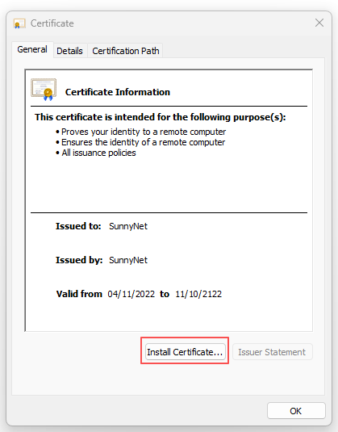
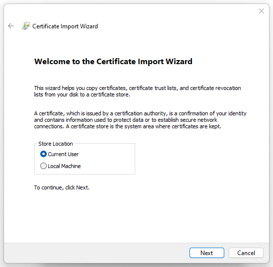
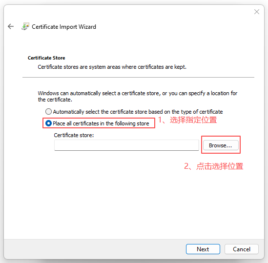
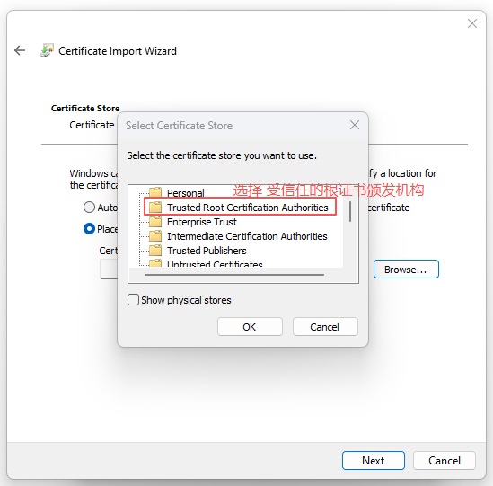
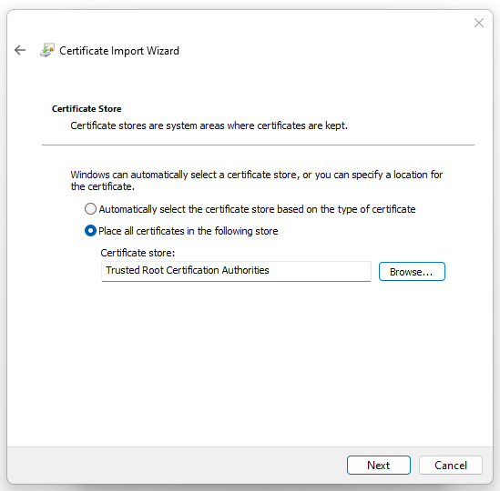
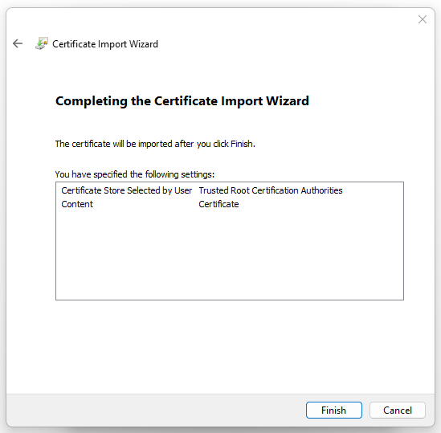
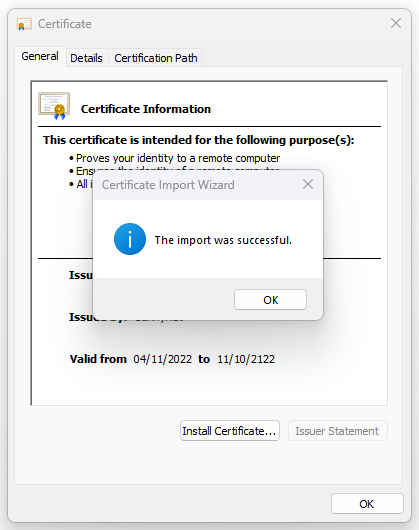
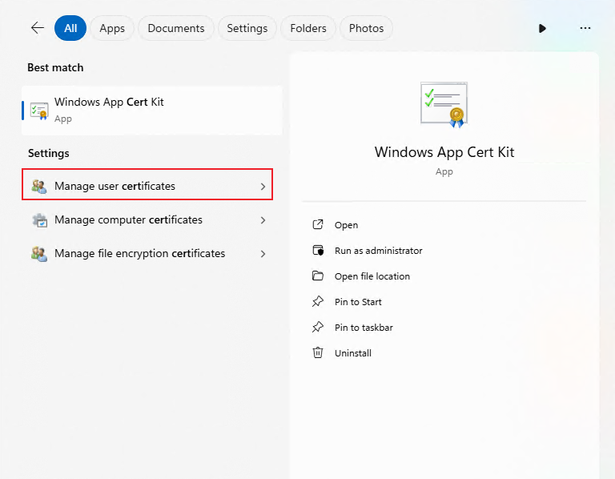
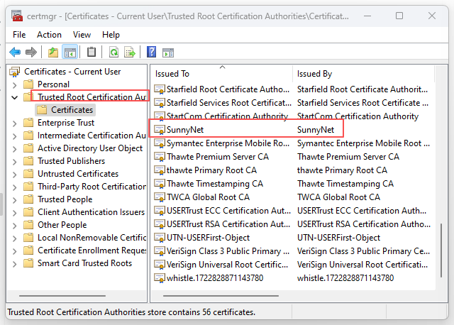
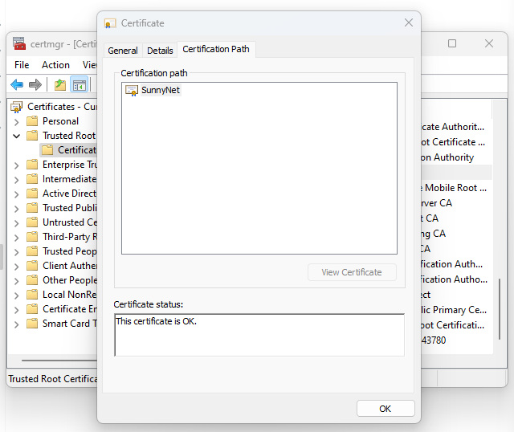

# 手动安装根证书

安装根证书的目的是拦截并修改视频号响应，从而实现插入下载按钮。当自动安装失败时，可以参考该文档手动安装根证书

> 安装根证书会影响所选用户或系统的信任链，请仅在充分信任的前提下进行。如果担心根证书风险，可以安装自己的根证书。参考 [证书配置](../config/cert.md)

### 下载安装

启动下载器后，通过本机接口下载当前使用的根证书（默认 API 地址为 `http://127.0.0.1:2022`）：

```bash
curl -o ~/Downloads/root-ca.pem http://127.0.0.1:2022/api/proxy/certificate/pem
```

如需手动安装，可设置 `proxy.skipInstallRootCert: true` 跳过自动安装。请使用本机生成的证书，勿下载或安装旧版共享 SunnyNet 根证书。


## Windows
- 下载根证书文件并双击打开
- 按向导选择“本地计算机”，并安装到“受信任的根证书颁发机构”
- 也可通过 MMC 管理单元手动导入









查看是否安装成功





## macOS

程序默认将证书安装到当前用户的“登录”钥匙串，并设置用户级信任。通过 `sudo` 启动时，证书操作会切回原用户执行。

也可以手动安装，以下命令以使用微信的普通用户身份执行：

```bash
security add-trusted-cert -r trustRoot \
  -k "$HOME/Library/Keychains/login.keychain-db" \
  "$HOME/Downloads/root-ca.pem"
```

不要添加 `-d`（管理员信任域）或 `-p`（限制信任策略）。钥匙串可能提示解锁或确认授权。

安装后验证 SSL 和 basic 两种策略，两个命令都应成功：

```bash
security verify-cert -c "$HOME/Downloads/root-ca.pem" -p ssl -l -L -q
security verify-cert -c "$HOME/Downloads/root-ca.pem" -p basic -l -L -q
```

也可双击证书，在“钥匙串访问”中选择“登录”钥匙串，展开证书的“信任”，将“使用此证书时”设为“始终信任”。

用户级信任用于同一用户下的微信等应用。旧版安装在“系统”钥匙串中的 SunnyNet 证书仍需清理；从设置中卸载旧系统证书时仍会请求管理员授权。设置系统代理或启用 TUN 的权限需求不受此变更影响。

## Linux

下载 `root-ca.pem` 后，根据发行版选择对应命令安装到系统根证书库。

### Debian / Ubuntu

```bash
sudo mkdir -p /usr/local/share/ca-certificates
sudo install -m 0644 ~/Downloads/root-ca.pem /usr/local/share/ca-certificates/WeChatAppEx_CA.crt
sudo update-ca-certificates --fresh
```

### Fedora / RHEL / CentOS

```bash
sudo mkdir -p /etc/pki/ca-trust/source/anchors
sudo install -m 0644 ~/Downloads/root-ca.pem /etc/pki/ca-trust/source/anchors/WeChatAppEx_CA.crt
sudo update-ca-trust extract
```

### Arch / Manjaro

```bash
sudo mkdir -p /etc/ca-certificates/trust-source/anchors
sudo install -m 0644 ~/Downloads/root-ca.pem /etc/ca-certificates/trust-source/anchors/WeChatAppEx_CA.crt
sudo trust extract-compat
```

安装后重启微信和下载器。如果浏览器、Chromium/Electron 应用仍然提示证书不受信任，可以额外写入当前用户的 NSS 证书库：

```bash
mkdir -p ~/.pki/nssdb
[ -f ~/.pki/nssdb/cert9.db ] || certutil -d sql:$HOME/.pki/nssdb -N --empty-password
certutil -d sql:$HOME/.pki/nssdb -D -n WeChatAppEx_CA 2>/dev/null || true
certutil -d sql:$HOME/.pki/nssdb -A -n WeChatAppEx_CA -t "CT,C,C" -i ~/Downloads/root-ca.pem
```

`certutil` 命令由 `libnss3-tools`（Debian / Ubuntu）或 `nss-tools`（Fedora / RHEL / CentOS）提供，Arch / Manjaro 可安装 `nss`。
